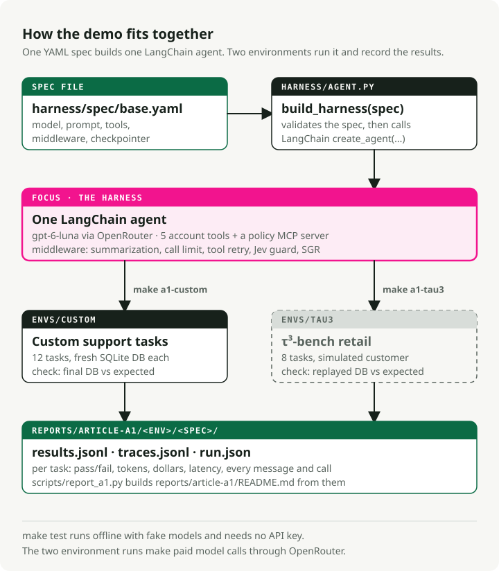
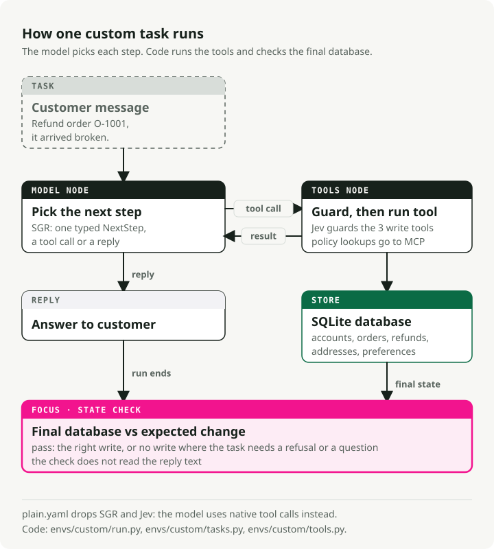

# Parts 2 and 3: one agent, then five designs

The lab started as the companion of two earlier articles in the series
**Recursive Harness Engineering**. Each article quotes the runs saved at its tag.

| Part | Article | Tag | Make targets |
| --- | --- | --- | --- |
| 2 | [Designing an agent harness: from task to architecture](https://slavadubrov.com/blog/2026/09/28/first-langchain-agent-harness/) | [`v0.1.2-a1`](https://github.com/slavadubrov/agent-harness-lab-public/tree/v0.1.2-a1) | `a1-*` |
| 3 | [Agent or workflow: five designs for one support assistant](https://slavadubrov.com/blog/2026/10/08/agent-to-workflow/) | [`v0.2.1-a2`](https://github.com/slavadubrov/agent-harness-lab-public/tree/v0.2.1-a2) | `a2-*` |

In file, folder and target names, `a1` marks what Part 2 added and `a2` what Part 3 added.

<picture>
  <source media="(prefers-color-scheme: dark)" srcset="img/overview.dark.svg">
  
</picture>

## How one task runs

<picture>
  <source media="(prefers-color-scheme: dark)" srcset="img/one-task.dark.svg">
  
</picture>

- The model chooses every step. There is no fixed pipeline.
- The tools check only that the data exists and the refund amount fits. The agent must
  check ownership and policy itself, so a run can expose a write the policy forbids.
- A task passes when the final database matches the expected change. Seven of the
  twelve tasks expect no change: the agent must refuse or ask a question.

## The specs

| Spec | What it contains |
|---|---|
| [`plain.yaml`](../harness/spec/plain.yaml) | Native tool calling, summarization, a limit of 20 model calls per run, 2 retries on a tool error, read tools only |
| [`base.yaml`](../harness/spec/base.yaml) | Everything in `plain`, plus Schema-Guided Reasoning (SGR) and a Jev guard on the three write tools |
| [`approval-agent.yaml`](../harness/spec/approval-agent.yaml) | `plain` plus LangChain's `HumanInTheLoopMiddleware`, which pauses before a refund above $200 |
| [`workflows/refund-approval.yaml`](../harness/spec/workflows/refund-approval.yaml) | The `plain` agent, then code that waits for the supervisor, issues the approved refund and writes the reply |
| [`workflows/support-router.yaml`](../harness/spec/workflows/support-router.yaml) | A Jev classifier sends each request to one of three `plain` agents with fewer tools |
| [`workflows/support-code.yaml`](../harness/spec/workflows/support-code.yaml) | No agent: one model call reads the message into fields, and code checks the policy, writes and replies |

`glm-5.3-flash.yaml` and `mimo-v2.6-flash.yaml` are `base.yaml` with another model.
`workflows/support-router-clarify.yaml` adds a route that asks the customer to clarify.
`workflows/do-nothing.yaml` makes no model call, no write and no reply: Part 4's baseline.

## Run them

These targets call a model through [OpenRouter](https://openrouter.ai) and need an API
key in `.env` (`cp .env.example .env`, then set `OPENROUTER_API_KEY`).

```bash
make a2-matrix                              # Part 3: five designs on the 16 support tasks
make a2-routes                              # Part 3: score both routers on 25 labelled requests
make a2-custom SPEC=harness/spec/workflows/refund-approval.yaml   # Part 3: one design
make a1-custom SPEC=harness/spec/plain.yaml # Part 2: 12 support tasks
make a1-tau3   SPEC=harness/spec/plain.yaml # Part 2: 8 τ³-bench retail tasks
```

Without `SPEC`, the `a1-*` targets use `base.yaml`. Each run prints one line per task
and replaces the files under `reports/article-<a1 or a2>/<env>/<spec>/`. Use `git diff`
to compare your run with the saved one. The Part 3 runs cost about $0.02 in total at
2026-10-05 prices.

## Results

[`reports/article-a2/NOTES.md`](../reports/article-a2/NOTES.md) (Part 3) and
[`reports/article-a1/NOTES.md`](../reports/article-a1/NOTES.md) (Part 2) summarize the saved
single runs; the `README.md` next to each has the per-task tables. Each row is a single
run per task, so small differences between rows are not measured effects.
[`reports/part-4/RESULTS.md`](../reports/part-4/RESULTS.md) grades 10 runs per design with
intervals, and [`reports/part-4/README.md`](../reports/part-4/README.md) says how they were made.

Part 2 quotes the runs saved at tag
[`v0.1.2-a1`](https://github.com/slavadubrov/agent-harness-lab-public/tree/v0.1.2-a1/reports/article-a1).
[`reports/article-a1-rerun-2026-09-26/`](../reports/article-a1-rerun-2026-09-26/) keeps a later
rerun of the same specs on this repository; its τ³-bench results differ by one task per spec.

## More detail

| Document | Read it to learn |
|---|---|
| [How the harness works](how-it-works.md) | How a spec becomes an agent, where each middleware runs, what SGR and Jev do, what is recorded |
| [The environments](environments.md) | The support tasks and their checks, and how the τ³-bench adapter works |
| [Writing a spec](specs.md) | The spec format, `extends:`, tool sources, custom middleware and workflow specs |
